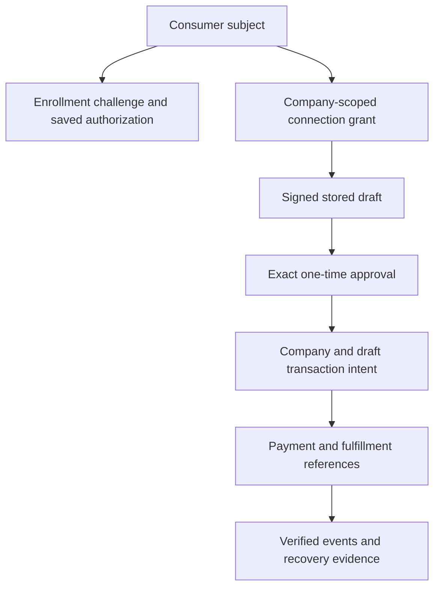

# Security, identity and data

## Security model

Trusted authorization comes from verified identities, server-owned grants, signed immutable state and provider evidence. Captions, product descriptions, user messages, retrieved pages and model outputs are untrusted data. They cannot override policy or provide an approval capability.

| Threat | Implemented control / boundary |
| --- | --- |
| Cross-consumer access | OIDC subject-derived enrollment/status and connection ownership checks |
| Cross-company access | Principal company scope, account normalization and server connection resolution |
| Stolen SetupIntent enrollment | Server-created subject/Shop/customer/SetupIntent challenge; exact verification and atomic consume |
| Browser payment substitution | Strict enrollment body allowlist; server-resolved saved authorization |
| Changed cart/price/authorization | Signed exact draft, hash/amount/currency/payment binding and live pre-execution revalidation |
| Approval replay | Expiring one-time JTI and persistent consumption |
| Agent overreach | Company agent registry, capability grants, per-account policy and readiness |
| Prompt injection | State-based proposal validation; no model authority; public-only tool results |
| Duplicate fulfillment | Persisted payment references, conditional execution claims and webhook event deduplication |
| Lost provider response | Reconciliation rather than blind creation retry |
| Fraudulent callback | Raw-body Stripe/Shopify signature validation and event persistence |
| Secret leakage | Server credential vault/encryption, model result allowlist and consumer-safe projections |
| Merchant redirect injection | Exact trusted Stripe authentication origin restriction |

These are implementation controls, not a certification or complete independent security assessment.

## Consumer identity

`apps/api/src/approval.ts` configures `OidcIdentityVerifier` with issuer, audience, JWKS and a ten-minute maximum authentication age. `SHOP_OIDC_USER_ID_CLAIM` identifies a trusted Shop user claim for the current enrollment profile. Client-provided subject/company/email values are not authority. Receipt email is accepted only when the verified token asserts `email_verified === true`.

OIDC linking and the actual trusted claim issuer must be configured and validated. Setting a claim name in the environment does not create a Shop integration. Generic company grants and generic approval remain independent of Stripe enrollment; the current Muse payment path deliberately requires the stronger saved-authorization binding.

## Credentials and keys

Company API credentials have hashed production records with capabilities, roles, expiry and revocation. Provider OAuth credentials are stored through the server vault with encryption-key configuration. Draft, approval, audit, link and OAuth-state signing serve different purposes and must use managed secrets rather than reused demo values.

Do not put tokens, client secrets, payment method references, addresses or approval proofs into training examples, logs, screenshots or support messages. Do not expose connected-account IDs as the consumer payment label; use a safe label such as “Saved payment.” Key rotation must preserve the ability to decrypt required existing records and verify in-flight artifacts until explicitly expired; use the vault/runtime rekey paths and verify tenant-level results.

## Persistence inventory

`infra/db/schema.sql` initializes the foundational gifting tables. Runtime modules also create/extend operational tables; the SQL file is not a complete production schema migration history.

| Data group | Tables / implementation |
| --- | --- |
| Foundational gifting | `organizations`, `api_keys`, `recipient_passports`, `recommendation_events`, `bundle_telemetry_events`, `group_gift_events`, `contributions`, `fulfillment_observations`, `audit_events` |
| Consumer commerce | `consumer_commerce_identities`, `consumer_enrollment_challenges` in API identity/enrollment stores |
| API credentials/rate limit | `api_credentials`, `api_rate_limit_buckets` |
| Generic authorization | `connector_connections`, `connector_drafts`, `replay_consumptions` in gateway PostgreSQL authority |
| Provider authorization | `provider_connections`, `provider_credentials`, `provider_oauth_transactions` |
| Agent admission | `provider_agent_registry`, `provider_agent_policies`, `provider_readiness_evidence` |
| Transaction lifecycle | `provider_transaction_intents`, `provider_webhook_events` |
| Operational evidence | `provider_operational_events`, `provider_alert_state`, `security_audit_streams`, `security_audit_records` |

Consumer enrollment stores subject, Shop identifier, Stripe customer/setup/payment-method references, timestamps and optional verified email. Transaction intents are keyed by company and draft; they include consumer ownership, payment/fulfillment account scope, payload, total/currency, external references, approval JTI, state and recovery note. Payment references have uniqueness constraints. JSON payloads may contain sensitive fulfillment details and require access/retention controls.

## Audit and recovery integrity

Security audit streams maintain ordered records and event hashes. Provider actions use configured audit signing and correlation IDs. A consumer-visible success message is not audit evidence. Keep signed records and provider event references available for reconciliation; restrict operator notes to necessary factual evidence.

Database restore can reintroduce previously consumed nonces, stale grants and incomplete transaction claims. Before re-enabling execution after restore, reconcile external provider outcomes and verify replay/credential state. Backups need encryption, access limits and tested restore procedures. Retention, deletion, legal basis and jurisdiction requirements must be defined by the operating business; the repository does not establish a compliance program.

## Known production review items

- The API currently constructs its production PostgreSQL pool with `ssl: { rejectUnauthorized: false }`. This is an existing certificate-validation limitation to review and remediate with the intended database trust configuration; it must not be described as strict TLS peer verification.
- Several stores initialize schema at runtime. A controlled migration/rollback process and least-privilege runtime database role need operational design.
- Presence-based readiness is necessary but insufficient: verify provider permissions, claim provenance, secret validity, event delivery and revocation behavior.
- Enforce request/log redaction, retention, observability access, backups, credential rotation and independent security review before public launch.
- Protect the actual human confirmation integration from model self-approval and validate its account-linking trust boundary.

See [SECURITY.md](../../SECURITY.md), [zero-trust production guidance](../operations/zero-trust-production.md) and [operations](operations.md). Do not publish a new security contact or policy that the project owner has not established.
