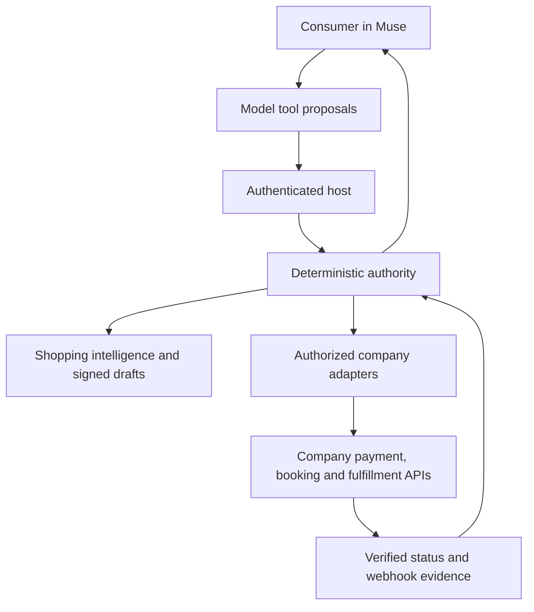

# System architecture

## Purpose and scope

MUSE SHOPPING INDEX connects Muse's reasoning to deterministic commerce tools. It combines shopping intelligence, explicit permissions, exact review, transaction execution and post-purchase recovery. The system is intended for all authorized companies, including businesses that fulfill bookings or services rather than physical parcels.

The architecture separates the universal contract from its current concrete payment/order implementation. `CompanyConnectorAdapter` provides search, draft and execute. `ZeroTrustConnectorAdapter` adds revalidation and idempotent commit. The authenticated Muse continuation currently invokes the Stripe/Shopify transaction implementation. A company with a different payment or fulfillment API must implement and wire the corresponding capabilities; synthetic training coverage does not supply that integration.

## Authority boundaries

| Component | Owns | Must not infer |
| --- | --- | --- |
| Muse | Intent interpretation, next-tool proposal, consumer explanation | Permission, approval, payment success or fulfillment from generated text |
| Shopping Intelligence Index | Normalization, evidence-backed ranking and learning contracts | Live availability or final price without provider evidence |
| Company adapter | Authorized source access, live quote/configuration, commit and lifecycle evidence | Capabilities that the company has not granted |
| Signal Shield/policy | Deterministic action/risk decisions | A model exception to business rules |
| Transaction authority | Identity binding, signed draft/approval, replay, durable state | Completion from a timeout or unverified callback |
| Provider | Actual payment, order, booking and fulfillment outcomes | Platform consumer authorization |
| Operator | Evidence-based exception resolution and deployment configuration | Successful external actions solely because CI passes |

## Workspace responsibilities

| Workspace | Responsibility |
| --- | --- |
| `apps/api` | Node HTTP entry point, OIDC approval/enrollment, API principals, provider connections, runtime controls, drafts, transaction store, webhook handling, status, recovery and readiness |
| `apps/demo` | Credential-free competition experience, Reel context, model policy and inference, native function loop, synthetic model evaluation |
| `apps/business` | Company/provider console and intelligence presentation modules |
| `apps/storefront` | Consumer gifting/review modules; optional presentation surface, not the required Muse interface |
| `services/mcp-gateway` | MCP tool registration, generic company connectors, zero-trust authority, OAuth state, provider adapters/refresh, vault and security audit |
| `services/payments` | Payment state/contracts and Stripe adapter |
| `services/shopify-adapter` | Shopify product normalization and Signal Verified derivation |
| `services/shopify-webhooks` | Signed Shopify webhook verification |
| `services/gift-intelligence`, `bundle-orchestrator` | Recommendations, relevance, batch/bundle composition |
| `services/signal-shield` | Capability/risk enforcement |
| `services/fulfillment`, `group-gifting` | Delivery confidence/telemetry and event contribution ledger |
| `services/link-authority` | Scoped signed, expiring/revocable links |
| `services/telemetry-store`, `ops-engine` | Telemetry persistence and exception classification |
| `packages/shopping-index` | Normalized shopping intelligence, learning and company-learning contracts |
| `packages/commerce-network` | Consumer permissions, trust, plans, attribution, loyalty, recovery and diagnostics contracts |
| `packages/gift-graph`, `schemas` | Preference/outcome graph and shared domain types |
| `packages/zero-trust`, `policy`, `audit`, `telemetry` | Shared verification, policy, audit and instrumentation primitives |

Workspace packages are modules in a monorepo; their existence does not imply separately deployed microservices. The API and demo have distinct start commands. API imports the demo package's pure model subpath exports rather than its HTTP server entry point.

## Integration planes

The **consumer plane** verifies OIDC and derives subject, trusted Shop claim and verified email server-side. It handles enrollment, exact approval and owned status.

The **company control plane** authenticates API credentials, scopes operations to the principal's company, authorizes agents and capabilities, manages provider OAuth/vault state, and evaluates readiness evidence. Client-declared permissions are not authoritative.

The **model plane** receives a constrained public server snapshot and proposes tools. The native runner preserves assistant/tool-call IDs, dispatches serially, refreshes context and bounds execution. Sensitive event data is returned separately to the authenticated consumer rather than echoed into model tool results.

The **execution plane** persists transaction intent and payment references before asynchronous confirmation, guards fulfillment claims, processes verified events, and classifies uncertainty for reconciliation.

## Company onboarding

1. Establish company authority, ownership and required verification evidence.
2. Implement supported search/draft/execute/status capabilities against authorized APIs.
3. Store credentials in the server vault and create scoped consumer/company connections.
4. Register and authorize the agent and its per-account limits.
5. Revalidate quote, availability, configuration and terms before commit.
6. Prove idempotency and recovery with injected response loss and replay.
7. Validate company-specific cancellations, refunds and fulfillment evidence.

Do not require Shopify credentials for an unrelated company's adapter. The current API's production readiness implementation still checks the reference adapter; a new production execution profile needs its own explicit readiness wiring. See [adapter contract](../company-adapter-contract.md).

## Product intelligence boundary

The gifting concierge restricts recommendation eligibility to Signal Verified products with verified context, purchasable variants, valid price, imagery and availability. Agent admission additionally considers freshness and semantic completeness. These gifting rules coexist with broader company booking/service contracts; they are not evidence that every catalog is verified.

## Architecture decisions

- Keep business authority deterministic so changing the model cannot change approval rules.
- Store exact drafts server-side so mutable browser/model payloads cannot alter approved state.
- Bind reusable payment authorization to Muse approval so payment rotation requires reapproval.
- Prefer direct server payment; allow trusted payment authentication only when required.
- Treat uncertain external success as reconciliation rather than automatic new execution.
- Delegate payment receipts and merchant notifications to the underlying providers.
- Keep training synthetic and distinguish inference, training and transaction evidence.

Native Meta/Reels distribution, full conversation entry-to-draft wiring, actual account linking/confirmation callbacks, live company admission and model weight training remain separate workstreams.
