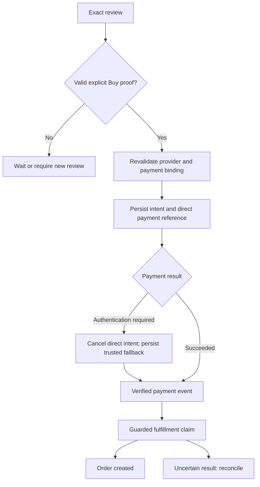

# Transaction lifecycle and invariants

## Enrollment: reference payment adapter

Source: `apps/api/src/consumer-enrollment.ts`, `consumer-commerce-identity.ts`, and `services/payments/src/stripe.ts`.

1. Authenticated consumer sends `{}` to `POST /v1/consumer-commerce/enrollment/start`.
2. Server requires the trusted Shop identity claim, creates a fresh Stripe customer and SetupIntent, and stores a ten-minute challenge bound to subject, Shop user, customer and SetupIntent.
3. Only `enrollmentId` and Stripe `clientSecret` return to the consumer. The authorized client confirms the setup with Stripe; the model does not handle payment credentials.
4. Consumer posts only `{ "enrollmentId": "<challenge UUID>" }` to `/complete`.
5. Server verifies the same subject/Shop user, expiry and unconsumed state; retrieves the exact stored SetupIntent; requires succeeded, off-session, matching customer and a valid payment method.
6. A PostgreSQL statement atomically consumes the challenge and persists the consumer commerce identity. A concurrent replay cannot enroll twice.

Start/complete reject extra body keys. The client cannot select subject, customer, payment method or arbitrary SetupIntent. The legacy direct enrollment endpoint returns 410. Each new challenge creates a new customer in the current implementation; customer reuse/lifecycle cleanup should not be assumed.

## Draft and exact review

An authorized provider/connector resolves products or offers and creates a server-signed draft. The review must reflect the exact authoritative seller, items/configuration, destination/service details, fees, tax, total, currency and terms. Missing information should be collected in a consolidated question where possible.

The current Muse host begins with an existing `connectionId` and `draftId`. Reel interpretation and generic company draft tooling exist, but the production native Meta entry-to-draft integration is not completed by invoking `/v1/muse/agent`.

## Human approval

The generic `/v1/approvals/issue` route remains rail-independent. The Muse-specific `/v1/muse/approvals/issue` route additionally resolves and binds the subject's saved payment authorization server-side. Both require verified human identity and an explicit approval request for the displayed draft hash.

Approval binds consumer subject, company, connection, draft ID, exact draft hash, total, currency, expiry and consume-once JTI. Muse payment approval also binds the saved authorization reference. Any relevant change requires fresh review and approval. The model must not receive approval issuance as a self-approval tool or manufacture trusted proof from text such as “buy it.”

## Execution and payment

`submitMuseConfirmation` independently verifies ownership, signed draft, actual approval, payment binding, runtime policy and live landed totals. Live drift fails before approval consumption and before payment execution.

The reference implementation prefers a saved Stripe PaymentIntent. It persists the payment reference before confirmation/webhook processing so asynchronous payment success can resolve the same intent. Authentication-required direct payment is canceled before persisting `PAYMENT_FALLBACK_PENDING` and creating trusted Stripe Checkout. Retries resume the fallback and do not reconfirm the canceled PaymentIntent.

Only exact `https://checkout.stripe.com` origin URLs are trusted fallback destinations; userinfo and custom ports are rejected. This is payment authentication, not an arbitrary merchant checkout handoff. Existing Checkout retrieval validates session ID, company/draft metadata, amount, currency and payment mode. Only open/unpaid sessions expose an authentication URL. Paid or expired sessions do not create another payment.

## Persisted reference states

Source of truth: `ProviderTransactionState` in `apps/api/src/provider-transaction-store.ts`. These names describe the concrete transaction record, not every possible company booking state machine.

| State | Meaning and safe action |
| --- | --- |
| `CHECKOUT_PENDING` | Intent exists; payment/order completion is not established |
| `DRAFT_PREPARING` | Provider draft preparation is claimed/in progress |
| `CHECKOUT_CREATED` | Payment reference exists; final payment/fulfillment must be verified |
| `PAYMENT_FALLBACK_PENDING` | Direct payment required authentication; resume trusted fallback |
| `ORDER_EXECUTING` | Paid transaction has a guarded fulfillment execution claim |
| `ORDER_CREATED` | Provider order identifier persisted |
| `RECONCILE_REQUIRED` | External completion is uncertain; inspect provider evidence before resolving |
| `REFUND_REQUIRED` | Compensation required after evidenced absence/failure of fulfillment |
| `REFUND_EXECUTING` | Refund submission/recovery claimed |
| `REFUND_SUBMITTED` | Refund reference exists; wait for verified finality |
| `REFUNDED` | Verified refund completion recorded |

Not every row transitions directly to the next. Conditional SQL claims, execution services and verified events define permitted transitions. Do not update states manually to manufacture a successful demonstration.

## Fulfillment and uncertainty

Verified Stripe Checkout or PaymentIntent success drives Shopify draft completion in the reference adapter. Conditional database claims guard order creation under concurrent/replayed webhooks. This is an exactly-once execution guard, not a claim that distributed external side effects are universally exactly once.

If the provider may have completed but the response is lost, persist `RECONCILE_REQUIRED`. An operator uses provider evidence to choose `CONFIRM_ORDER` with an order identifier, or `NO_ORDER` to enter compensation. Both require a recorded note. Never retry creation merely because an HTTP response timed out.

## Refunds

Refund submission is distinct from finality. Recovery coordinates stale/in-progress refunds and verified webhook outcomes. A failed or uncertain refund remains actionable; a successful submission is not described as refunded before final evidence. Operator endpoints require `admin_override`, company scope and configured audit.

## Consumer status and notifications

`GET /v1/muse/orders/:draftId` derives the buyer from OIDC and reads only the owned transaction. It exposes persisted state, payment/order projection, provider order ID and safe fulfillment/tracking data. Tracking states are `PENDING`, `AVAILABLE` and `UNAVAILABLE`; `AVAILABLE` means a provider order was retrieved, not that a package has been delivered or even has a tracking number.

The current `paymentStatus` is a coarse `PAID`/`PENDING` projection and can remain `PAID` for refund states. Consumers must inspect the transaction state for refund progress; do not interpret this field as net financial settlement.

Stripe owns payment receipt delivery; Shopify/Shop owns merchant order notifications in the reference implementation. Email is derived only from verified OIDC (`email_verified === true`), not a browser-selected receipt address. API success does not prove email delivery or Shop-app visibility. Muse owns status, tracking and recovery presentation without sending duplicate transaction emails.

For bookings, services, pickup and digital goods, completion depends on the adapter's verified lifecycle evidence. A parcel tracking number is not a universal completion requirement.
